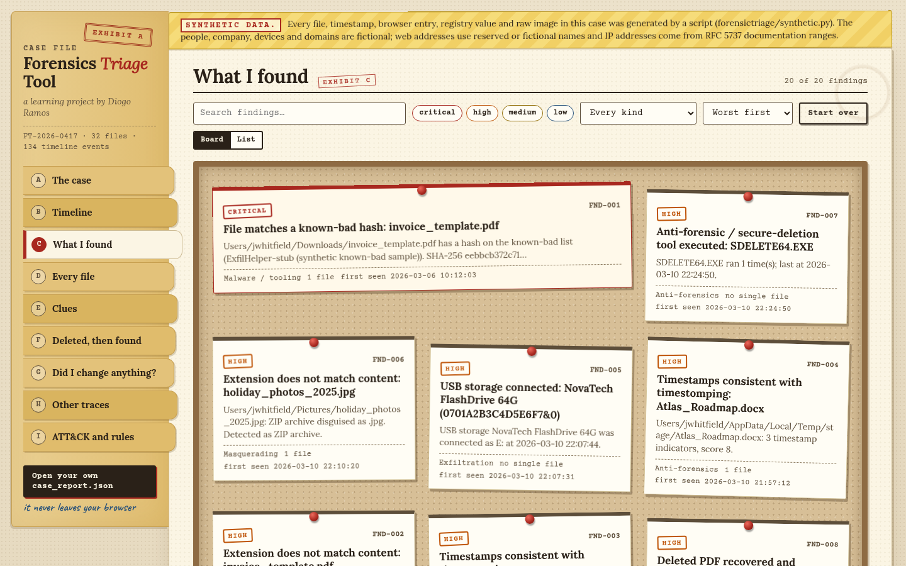
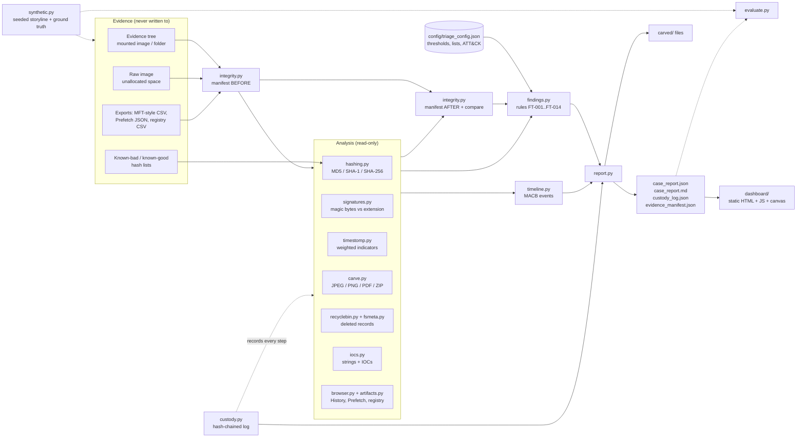

# Forensics Triage Tool

A command-line tool I wrote in Python (standard library only) to practise the first hour of a disk investigation. You give it a folder of evidence and a raw disk dump. It opens everything **read-only** and writes a JSON and Markdown case report, plus a small static dashboard that looks like a paper case file. It tries to answer the questions an examiner gets asked first: which files are known-bad, which ones aren't what they claim to be, which dates were faked, what was deleted but can still be recovered, and can I show that I didn't change anything while looking.

I'm teaching myself digital forensics for the GCFE, and this is where I put the reading to the test.

- **Hashes** every file (MD5, SHA-1, SHA-256) and checks them against known-bad and known-good lists
- **Builds a MACB-style timeline** from file system times, NTFS `$STANDARD_INFORMATION` / `$FILE_NAME`, browser history, Prefetch, registry, the Recycle Bin and dates inside documents
- **Spots files in disguise** (a ZIP named `.jpg`, an executable named `.pdf`) and **timestomping**
- **Carves deleted JPEG, PNG, PDF and ZIP files** out of a raw image by checking their internal structure, and reads Recycle Bin `$I` records and deleted MFT entries
- **Pulls out IOCs** (IPv4, URLs, emails, hashes, Windows paths) from files, including UTF-16 text and the inside of ZIP and Office files
- **Reads artefacts**: a Chrome-style `History` SQLite database, a Prefetch-style JSON export and a registry-style CSV export (USB devices, recent documents)
- **Keeps a hash-chained custody log** and hashes the whole evidence set before and after, to show nothing moved

> **Everything in the sample is synthetic.** The case in `data/synthetic/` comes from `forensictriage/synthetic.py` with a fixed seed. The company, employee, host and USB stick are made up, every text artefact says `SYNTHETIC`, web addresses use fictional `.example` domains, and IP addresses come from the documentation ranges (RFC 5737) or private ranges. The "known-bad" file is an inert text stand-in (`MZ` plus a sentence saying it isn't executable), not malware. I have **never run the tool on a real case or a real disk image**, so every number below describes this one synthetic set.

**Live demo (synthetic data):** https://forensics-triage-tool.vercel.app

## Why I made it

When someone is suspected of taking data, the first few hours of a review look the same every time: hash everything, find files that aren't what their name says, look for dates that were changed, check what was deleted, see what got plugged in, and write it up so somebody else can check your work. Doing that by hand on a disk image is slow, and the one mistake you can't undo is changing the evidence while you look at it. I wanted to understand what a triage tool actually does: how to read artefacts without touching them, how to tell a copied file from a timestomped one, how carving works when there's no file table to trust, and how to keep a custody record that can be checked instead of just claimed.

## What it does

- **Read-only on purpose.** Files are opened with `O_RDONLY` (plus `O_NOATIME` where the OS allows it), SQLite with `mode=ro&immutable=1`, symlinks are skipped and not followed, and the tool refuses to write its output inside the evidence folder.
- **Shows its work.** Before analysis every file gets its size, mtime, mode and three hashes recorded. Afterwards the tree is walked *again* (so a file added or removed mid-run gets caught) and compared. Any difference becomes a critical finding (`FT-900`) and exit status 4.
- **Explains each flag.** A timestomp verdict lists each indicator with its weight. A mismatch says what the bytes look like and what the extension expects. A deleted-file finding says which carved blob matches which Recycle Bin or MFT record, by hash or by size and type.
- **Gives copies the benefit of the doubt.** "Modified before created" on its own is what a normal copy from another disk looks like, so it's a low note and not an accusation. A *likely* timestomp needs several independent indicators (a score of 3 or more by default).
- **Carves by structure.** A JPEG is walked segment by segment and its scan data is followed to the real end-of-image, so an embedded thumbnail doesn't end the file early. A PNG is walked chunk by chunk with CRC-32 checks. A PDF is followed through `%%EOF` and incremental updates. A ZIP needs an end-of-central-directory record whose geometry makes sense and has to pass `zipfile.testzip()`. Each result is *complete* or *partial*, and false headers are counted and thrown out.
- **Grades itself** against `ground_truth.json`, which lists every planted behaviour, every look-alike that must *not* be flagged, the expected IOCs and the expected carving offsets. (It's my own storyline, see the limitations.)
- **Dashboard.** Styled as a case file: a manila-tab spine on the left, rubber-stamp counts, a vertical strip of what happened in order, an evidence board of findings (or a plain list, if you prefer), a timeline you can click into, a sortable file ledger, clues, a map of where each recovered file sat in the raw image, and a custody page that **recalculates the SHA-256 chain in your browser** and lets you edit an entry in memory to watch it break. "Open your own case_report.json" runs entirely in your browser.

## Screenshots

Taken in headless Chrome by `scripts/dashboard_smoke.js`, which also checks that the page behaves.

**The case: stamps, case card, the story in order, and a note from me**


**The evidence board (every finding pinned up, worst first)**


**Opening the critical finding (known-bad hash)**


**Timeline, hovering one hour**


**Custody page after editing one entry in memory and checking again**


**The deployed copy on Vercel**


**On a phone: the tabs become a strip across the top**

 

## How the pieces fit



## Running it

You need Python 3.10 or newer and nothing else to run the tool (pytest is only for the tests). I built it on Python 3.13.

```bash
git clone https://github.com/SomarGuy/forensics-triage-tool.git
cd forensics-triage-tool

python -m venv .venv
# Windows (PowerShell):  .venv\Scripts\Activate.ps1     Linux/macOS:  source .venv/bin/activate
pip install -r requirements-dev.txt        # pytest + pytest-cov (tests only)

python -m forensictriage demo              # make the synthetic case, triage it, check it, refresh the dashboard data
python -m pytest                           # 262 tests
python -m http.server 8000 --directory dashboard    # then open http://localhost:8000
```

To triage your own evidence (a folder or a mounted image) and carve a raw dump:

```bash
python -m forensictriage triage \
    --root /mnt/evidence --raw unallocated.dd \
    --known-bad bad_hashes.txt --known-good baseline_hashes.txt \
    --case-id CASE-001 --examiner "Your Name" --acquired-at "2026-03-16 08:30:00" \
    --out ./case-out --dashboard-json dashboard/data/case.json
# then open the dashboard, or use "Open your own case_report.json"

python -m forensictriage carve unallocated.dd --out ./carved       # carving only (--dry-run lists without writing)
python -m forensictriage verify --manifest reports/evidence_manifest.json \
    --base data/synthetic/case-FT-2026-0417            # re-hash later; --base is the common parent folder of the inputs
#   add --content-only when checking a copy or a git checkout (they change mtimes)
python -m forensictriage verify-custody case-out/custody_log.json
```

| Command | Purpose |
|---|---|
| `triage` | analyse evidence, print a summary, write the report, custody log, manifest and carved files |
| `carve` | carve JPEG / PNG / PDF / ZIP files from a raw image |
| `verify` | re-hash evidence against a saved `evidence_manifest.json` (exit 4 if anything changed; `--content-only` ignores mtime/mode, which copies and checkouts change) |
| `verify-custody` | check that a `custody_log.json` hash chain is intact and say where it breaks |
| `list-rules` / `validate-config` | show the rules / check a configuration file (non-zero exit if broken) |
| `generate` | write the synthetic case and `ground_truth.json` (`--seed N` for different noise) |
| `demo` | generate, triage, evaluate against ground truth, write `reports/` and `dashboard/data/case.json` |

Handy `triage` options: `--min-severity high`, `--fail-on high` (exit status 2 if any finding is at or above that severity), `--config` for your own lists and thresholds, `--no-colour`. Exit codes: `0` fine, `2` `--fail-on` tripped, `3` bad usage or input, `4` the evidence changed.

The domain lists (file sharing, webmail, archive and wiping tools, staging-folder names) live in `config/triage_config.json`. Edit them without touching code and run `validate-config`.

## Detection rules

There are 15, all defined in [`config/triage_config.json`](config/triage_config.json) with a severity, an ATT&CK mapping and recommended response steps. The thresholds are defaults I picked, not industry standards.

| ID | Detects | Severity | ATT&CK | Default trigger |
|---|---|---|---|---|
| `FT-001` | File on the known-bad hash list | critical | n/a | any MD5, SHA-1 or SHA-256 match (known-good wins if both list it) |
| `FT-002` | Extension does not match content | high / low | T1036.008 | bytes identify another format; low when the formats are siblings (JPEG saved as `.png`) |
| `FT-003` | Timestamps consistent with timestomping | high | T1070.006 | weighted indicator score ≥ 3 |
| `FT-004` | Weak timestamp anomalies | low | n/a | a single weak indicator, e.g. modified before created |
| `FT-005` | Deleted files recovered by carving | medium / high | T1070.004 | complete carve; high when matched to a Recycle Bin or MFT record |
| `FT-006` | Recycle Bin `$I` record without its `$R` content | medium | T1070.004 | `$R` file absent |
| `FT-007` | USB mass-storage device connected | medium → high | T1052.001 | arrival within 30 days of acquisition; high when archive, staging or wiping activity also exists |
| `FT-008` | Archive utility executed (Prefetch) | medium | T1560.001 | any run of a listed tool |
| `FT-009` | Secure-deletion / timestamp tool executed | high | T1070.004 | any run of a listed tool |
| `FT-010` | File-sharing or personal-webmail visits | medium | T1567.002 | domain on the configured lists (a visit is not an upload) |
| `FT-011` | Searches about deleting files or changing dates | medium | T1070.004 | search term matches a pattern |
| `FT-012` | Staging directory with business documents | medium | T1074.001, T1005 | ≥ 3 documents in a folder with a staging-style name |
| `FT-013` | External IOCs in user files | medium | n/a | external URL, IP or email in a user document or note |
| `FT-014` | MFT entries for deleted files | medium | T1070.004 | not-in-use entries whose files are absent |
| `FT-900` | Evidence changed during analysis | critical | n/a | any difference between the before and after manifests |

Timestomp indicators and weights (`timestomp_weights` in the config): `$SI` created earlier than `$FN` created (3), embedded document date later than the file system modified time (3), impossible value such as 1970 or pre-1980 (3), zero sub-second digits on `$SI` while `$FN` has them (2), future timestamp (2), modified before created (1).

## The synthetic case: an insider taking data

`data/synthetic/case-FT-2026-0417/` is a made-up workstation image: 32 files, a Chrome-style `History` database, a Recycle Bin, a 275 KB raw "unallocated space" dump, and MFT, Prefetch and registry exports. This is what the fictional employee does and where the tool should notice it:

| What the fictional employee did | Where the tool should see it |
|---|---|
| Stages `Q1_Customer_Pricing.xlsx`, `Atlas_Roadmap.docx`, `client_list.csv` in a Temp folder and zips them with 7-Zip | `FT-012`, `FT-008` |
| Renames the ZIP to `holiday_photos_2025.jpg` | `FT-002` (high): ZIP behind a `.jpg` extension |
| Copies it to a USB stick (E:) and opens it from there | `FT-007` (high): only the recent device; an older one stays quiet |
| Deletes the original archive, a PDF and a screenshot, and empties part of the Recycle Bin | `FT-005` (carved from the raw image, byte-identical to the renamed file), `FT-006`, `FT-014` |
| Sets the roadmap copy's dates back to January 2025 | `FT-003`: `$SI` earlier than `$FN`, whole-second times, document metadata says it was saved after that |
| Searches "how to change file modified date windows" and "delete files permanently windows no recovery" | `FT-011` |
| Visits a file-transfer site (upload page, then a share link) and a webmail compose page | `FT-010`; the link and a private address also appear as `FT-013` indicators |
| Runs a secure-delete tool | `FT-009` |
| Has an "invoice" that is really an executable stand-in on the known-bad list, with zeroed timestamps | `FT-001`, `FT-002`, `FT-003` |

I also planted look-alikes that must **not** be flagged: an ordinary copy (modified before created), an unzipped file with whole-second times, a `.jpeg` alias, a `.docx` that is really a ZIP container, a known-good baseline logo, a Recycle Bin record whose content is still there, and a USB device from months earlier. `ground_truth.json` lists all of it. Nothing in the evidence is malicious.

## Sample output

Console (`python -m forensictriage demo`, abridged):

```text
Case FT-2026-0417  [SYNTHETIC DATA]
  files 32 | findings 20 (1 critical, 9 high, 8 medium, 2 low) | carved 4 complete + 1 partial | indicators 12
  evidence integrity: VERIFIED UNCHANGED  (manifest sha256 542363fd5fa68f0b…); custody chain: chain intact
  FND-001 [CRITICAL] FT-001  File matches a known-bad hash: invoice_template.pdf
  FND-002 [HIGH]    FT-002  Extension does not match content: invoice_template.pdf
  FND-003 [HIGH]    FT-003  Timestamps consistent with timestomping: invoice_template.pdf
  FND-004 [HIGH]    FT-003  Timestamps consistent with timestomping: Atlas_Roadmap.docx
  FND-005 [HIGH]    FT-007  USB storage connected: NovaTech FlashDrive 64G (0701A2B3C4D5E6F7&0)
  FND-006 [HIGH]    FT-002  Extension does not match content: holiday_photos_2025.jpg
  ...
Evaluation against ground truth (case FT-2026-0417, SYNTHETIC data; graded against my own storyline)
  [PASS] GT-07 deleted archive recovered by carving and matched (FT-005 -> FND-010 high)
  [PASS] carved ZIP is byte-identical to the renamed file on disk
  ...
  RESULT: 21/21 scenarios, 9/9 must-not-flag checks, 0 unexpected -> ALL CHECKS PASSED
```

The whole synthetic case triages in well under a second on my machine (about 0.04 s, single-threaded). That's 32 small files and a 275 KB image, so it says nothing about real disks.

Markdown report excerpt (`reports/case_report.md`):

````markdown
## Evidence integrity and chain of custody

- Before: 38 files, 358,578 bytes, manifest SHA-256 `542363fd5fa68f0b5ee038563ba2f6c9835aaa58f7433b7f471b0e8e699a5f43`
- After:  38 files, 358,578 bytes, manifest SHA-256 `542363fd5fa68f0b5ee038563ba2f6c9835aaa58f7433b7f471b0e8e699a5f43`
- Result: **identical**; custody chain: chain intact

### FND-002 [HIGH] Extension does not match content: invoice_template.pdf

Rule FT-002 · Masquerading · first seen 2026-03-06 10:12:03 UTC · ATT&CK: T1036.008 Masquerading: Masquerade File Type

Users/jwhitfield/Downloads/invoice_template.pdf: executable content disguised as .pdf. Detected as MZ header without a valid PE header (DOS stub or truncated file).
````

`reports/case_report.json` is what the dashboard loads. It has `meta`, `summary`, `integrity` (before and after manifests plus the custody entries), `window`, `findings`, `narrative`, `files` (hashes, detected type, `$SI` / `$FN` times, timestomp indicators), `timeline`, `iocs`, `carved`, `deleted`, `browser`, `artifacts`, `mitre` and `rules`. `reports/carved/` holds the five carved files. The manifest digest above is the same on every run (the generator is seeded and the digest covers paths, sizes and hashes, not mtimes). The custody log timestamps are real wall-clock times, so they change each run. `git clone` doesn't keep file mtimes, so use `verify --content-only` on a fresh checkout.

## What's where

```
forensictriage/
  safeio.py          read-only file access, "output must be outside the evidence" check
  integrity.py       before/after manifests and comparison
  custody.py         hash-chained, append-only custody log + verifier
  hashing.py         MD5/SHA-1/SHA-256, known-bad / known-good lists
  signatures.py      magic-byte identification, extension expectations
  timeutil.py        100 ns timestamps, FILETIME / WebKit conversion
  fsmeta.py          MFT-style CSV ($SI/$FN), os.stat fallback, embedded document dates
  timestomp.py       weighted timestomp assessment
  carve.py           JPEG / PNG / PDF / ZIP carving with structural validation
  recyclebin.py      Recycle Bin $I parser (versions 1 and 2)
  browser.py         Chrome-style History (SQLite, read-only) parser
  artifacts.py       Prefetch JSON + registry CSV (USB, recent documents)
  iocs.py            strings (ASCII/UTF-16) and IOC extraction
  timeline.py        MACB-style event timeline
  findings.py        rules FT-001..FT-014 + FT-900 -> findings
  triage.py          orchestration (hash, analyse, re-hash, compare)
  report.py          JSON + Markdown writers
  evaluate.py        compare the report with synthetic ground truth
  synthetic.py       seeded synthetic case generator
  cli.py             argparse CLI
config/triage_config.json
data/synthetic/      the generated case + ground_truth.json (labelled SYNTHETIC)
reports/             case_report.json/.md, custody_log.json, evidence_manifest.json, evaluation.json, carved/
dashboard/           static site: index.html, app.js, style.css, fonts/, data/case.json, vercel.json
tests/               pytest suite
scripts/dashboard_smoke.js   optional headless-Chrome check + screenshots (needs playwright-core)
```

## Tests

```bash
python -m pytest                                        # everything
python -m pytest --cov=forensictriage --cov-report=term-missing
```

262 tests, and line coverage of the `forensictriage` package is 99% (`pytest-cov`). Coverage only shows the code ran, not that it's right, so the tests are built around behaviour: hash test vectors, each signature and its mismatch rule, hand-built carving cases (nested headers, truncated files, bad CRCs, false headers), every timestomp indicator and the "an ordinary copy isn't flagged" case, a tamper test for each kind of evidence change (content changed with the mtime put back, size, mtime, mode, removed, added) and for the custody chain (edited, deleted, reordered entry, plus the truncated-tail gap), the CLI end to end with exit codes, the synthetic generator (deterministic, labelled, documentation-range IPs only), and the committed samples and dashboard, which have to equal what the code produces today. Some of those dashboard checks are plain file checks: no inline scripts, no `innerHTML`, fonts served locally with their licences, a strict CSP, and no em dashes in the text I wrote.

A separate script, `scripts/dashboard_smoke.js`, drives the real page in headless Chrome: the folder tabs (mouse and arrow keys), filters, the board and list views, drill-downs, the timeline, the in-browser chain check and tamper detection, a phone-sized screen with no sideways scrolling, and a hostile `<script>` file name in an uploaded report staying inert.

## Limitations

It's a learning project, not a validated forensic tool, and nothing here has been tested for court. Please read the numbers with this in mind.

- **Self-graded.** I wrote the storyline, the planted artefacts and the detections, so "21/21 scenarios, 9/9 must-not-flag, 0 unexpected" only shows the tool does what I wrote it to do on data I designed. It is **not** a detection or false-positive rate for real cases. I haven't run it on a real disk or compared it with X-Ways, Autopsy, KAPE or anything similar.
- **Exports, not raw artefacts.** It reads a Prefetch-style JSON, a registry-style CSV and an MFT-style CSV, not binary `.pf` files, registry hives or the real `$MFT`. The MFT column names follow what I understand MFTECmd produces, but I've only tried them on my own synthetic export. Chrome's real `History` schema is much bigger than the part I generate.
- **Deleted-file recovery is simulated at the file-system level.** There's no FAT or NTFS parser. "Deleted" means a Recycle Bin `$I` record, an MFT-style row, or a carved file in a raw dump. Carving handles four types and whole (unfragmented) files only, and a `partial` carve is just a prefix whose structure was valid.
- **Timestomp detection is a heuristic and easy to dodge.** Someone who sets `$FN` too, or who picks plausible fractional seconds, won't trip these indicators. I weighted them so ordinary copies aren't accused, which also means a lone weak sign is only reported as low. Times are UTC with no time-zone handling, and a real tool would have to cope with `$FN` changing on moves and renames.
- **Integrity is shown, not guaranteed.** Read-only opens and the before/after comparison catch accidental changes made by this tool. There's no hardware write-blocker, `O_NOATIME` is best effort, and access times are deliberately left out of the comparison. The custody chain catches an edited, deleted or reordered entry, but **not a truncated tail**, and not someone who rewrites the whole chain and the report that quotes it. It isn't a signature and has no trusted timestamp.
- **IOC extraction is regex-based.** One pass over strings, with refanging (`hxxp`, `[.]`) and a list of noisy hosts. It will miss obfuscated or encoded indicators and it lets some false positives through. A Windows path stops at the first space in its last element, a trade-off so a path isn't glued to the sentence after it.
- **The lists are examples.** The file-sharing, webmail, archive-tool and wiping-tool lists are short, plus fictional `.example` domains. They aren't threat intelligence. Visiting a file-sharing site isn't proof of an upload, and searching "how to change a file date" isn't proof of intent. The report says so.
- **Scale.** Files are read in capped chunks, but the timeline and report are built in memory and the dashboard draws a few hundred rows at a time. I've only run it on 32 files.
- **The dashboard is a static snapshot** with no login. The hosted copy holds only the synthetic report. Files you open are parsed in your browser, and every value goes into the page as text and never as HTML, because file names and URLs in evidence are chosen by whoever planted them. The Vercel config sets a strict Content-Security-Policy.
- **The look is hand-built.** The case-file styling is plain CSS with three bundled open fonts (Lora, Courier Prime, Caveat, all under the SIL Open Font License, see `dashboard/fonts/LICENSES.txt`), no framework and no CDN. Handwriting is only for the little notes, never for data.

## Putting the dashboard online

`dashboard/` is a self-contained static site with no build step. On Vercel you can import the repository (the root `vercel.json` sets `outputDirectory` to `dashboard`) or deploy the `dashboard/` folder directly. Any static host works. Opening `index.html` straight from disk won't load the data, because browsers block `fetch()` on `file://`, so serve it with `python -m http.server` or use the "Open your own case_report.json" button. The in-browser chain check needs HTTPS or `localhost` (WebCrypto).

## What I learned

- **A copy is not a timestomp.** My first rule flagged "modified before created", and then it flagged every file copied from another disk, which is exactly what that pattern looks like. A verdict needs independent indicators (`$SI` earlier than `$FN`, zeroed sub-seconds, a document that says it was saved *after* the file system says it was modified), and a single indicator has to be a low note, not an alert. The `must-not-flag` list in the ground truth exists because of this.
- **Carving trusts structure, not headers.** Four bytes of `FFD8FF` turn up in places that aren't JPEGs, and ZIP members contain other ZIP headers. Stopping a JPEG at the first `FFD9` cuts it off at the embedded EXIF thumbnail, so the segment walker has to follow the scan data to the real end. Counting rejected and nested headers made it obvious when the carver was being fooled.
- **Evidence handling is mostly about what you don't do.** Opening files with `O_RDONLY` is the easy part. The rest is refusing to write output next to the evidence, not following symlinks out of the evidence root, walking the tree again afterwards (my first version reused the same file list, so a file added mid-run went unnoticed), and choosing what to compare (access times change when you read).
- **Checkout tools rewrite timestamps.** `git` and `unzip` reset modification times. That's why a forensic export, and not the on-disk mtime, has to be the source for the timeline, and why a whole-second timestamp can only be a weak signal.
- **A hash chain proves less than it looks like.** Editing, deleting or reordering an entry is caught. Chopping off the last entries isn't, and neither is rewriting everything. Writing that into the tests and this README taught me more than the chain itself.
- **Treat the data as hostile.** File names and URLs in evidence are chosen by someone else. `textContent`, a strict CSP and a smoke test that loads a `<script>` file name cost very little, and a security tool should get that right.
- **Making it feel like a case file took real decisions.** Hiding sections behind tabs meant the timeline canvas had no size until its tab opened, so it redraws on open. And a board with rotated cards looks great until one long hash in a summary pushes the page sideways on a phone.

## Tech

Python 3 (standard library: `hashlib`, `zlib`, `zipfile`, `sqlite3`, `struct`, `re`, `csv`, `json`, `argparse`, `dataclasses`, `ipaddress`), pytest, pytest-cov, HTML, CSS and vanilla JavaScript (canvas, WebCrypto, no dependencies), three open-licence fonts bundled locally, Mermaid for the diagram above, Playwright-core (optional, for screenshots), Git, Vercel for static hosting. Topics: digital forensics, file signatures, file carving, NTFS timestamps, timestomping, Recycle Bin, Chrome history, Prefetch, USB artefacts, chain of custody, MITRE ATT&CK.

## Licence

MIT, see [LICENSE](LICENSE). The bundled fonts keep their own licences (SIL Open Font License 1.1), see `dashboard/fonts/LICENSES.txt`.
