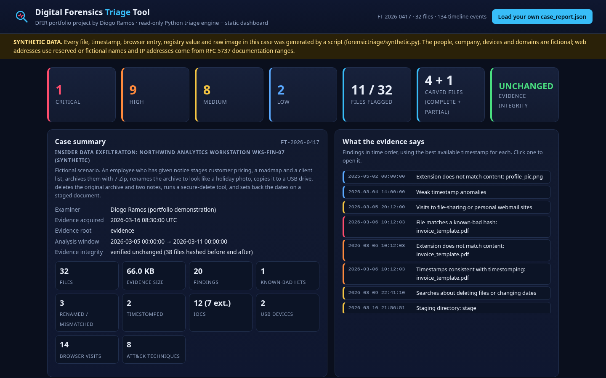
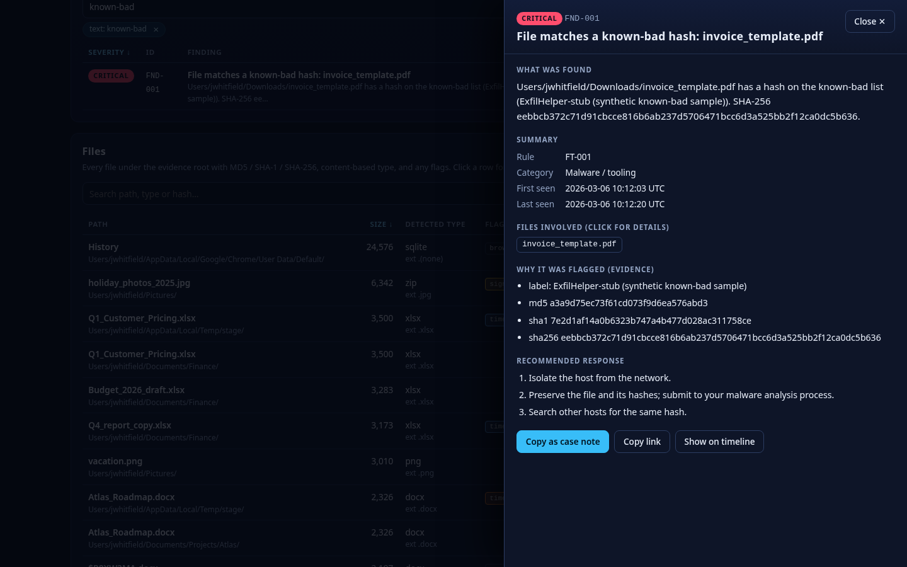
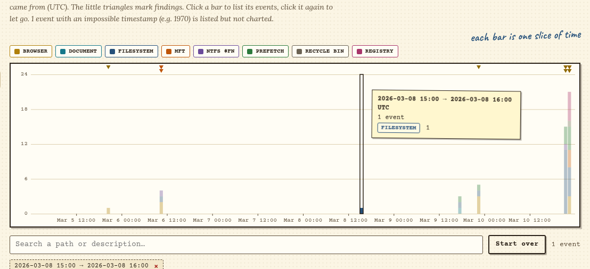
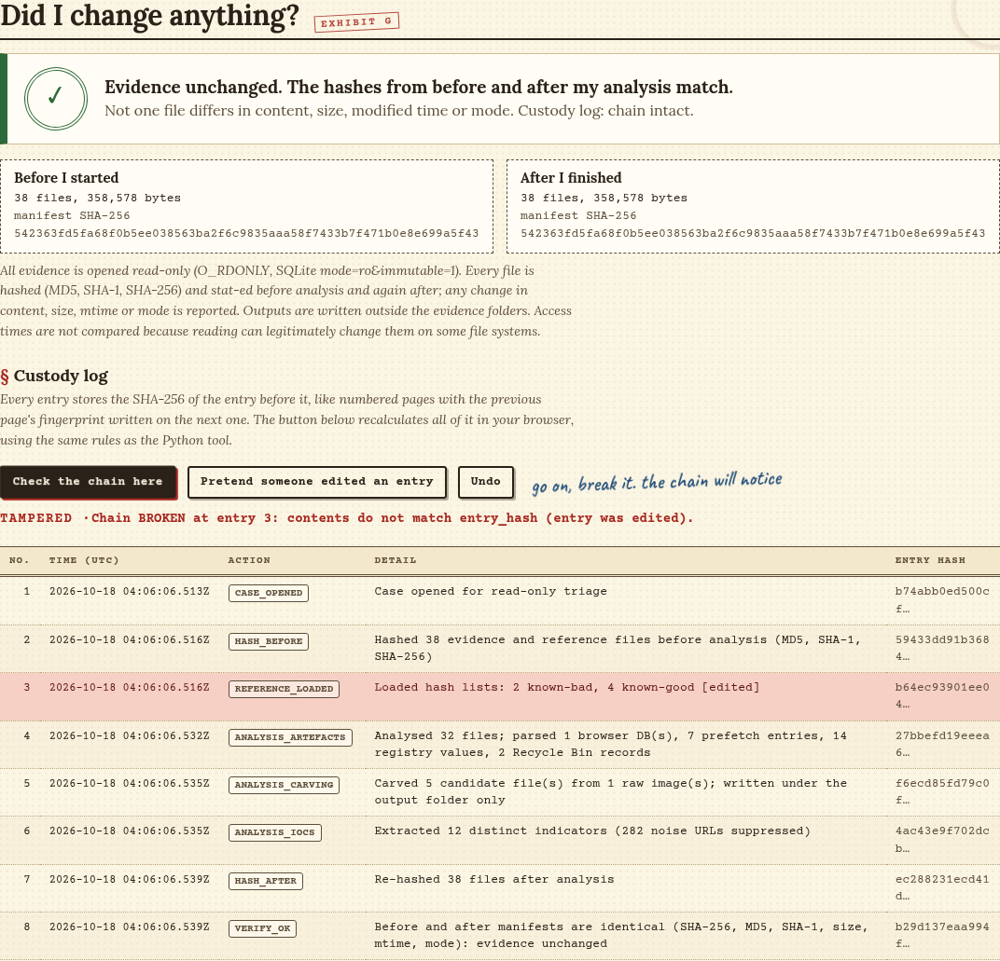
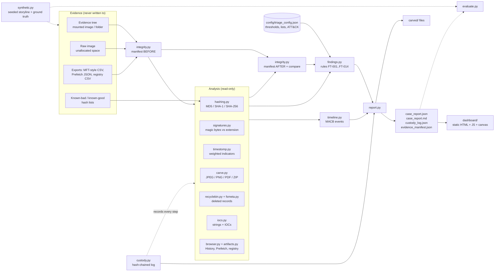

# Digital Forensics Triage Tool

A **Python 3** command-line tool (standard library only) that takes a folder of evidence and a raw disk dump, handles them **read-only**, and produces a **JSON and Markdown case report** plus a static **forensics dashboard** (dark theme, no build step). It answers the first questions an examiner is asked: *which files are known-bad, which are not what they claim to be, which timestamps were tampered with, what was deleted but is still recoverable, and can I prove I did not change the evidence?*

- **Hashes** every file (MD5, SHA-1, SHA-256) and checks the results against known-bad and known-good hash lists
- **Builds a MACB-style timeline** from file system, NTFS `$STANDARD_INFORMATION` / `$FILE_NAME`, browser, Prefetch, registry, Recycle Bin and document-metadata times
- **Detects extension / magic-byte mismatches** (an archive named `.jpg`, an executable named `.pdf`) and **timestomping indicators**
- **Carves deleted JPEG, PNG, PDF and ZIP files** out of a raw image by validating their internal structure, and reads Recycle Bin `$I` records and deleted MFT entries
- **Extracts strings and IOCs** (IPv4, URLs, emails, MD5/SHA-1/SHA-256 values, Windows paths) from files, including UTF-16 text and the inside of ZIP / Office documents
- **Parses artefacts**: a Chrome-style `History` SQLite database, a Prefetch-style JSON export and a registry-style CSV export (USB devices, recent documents)
- **Keeps a hash-chained chain-of-custody log** and hashes the whole evidence set **before and after** analysis to show nothing was modified

> **All sample data is synthetic.** The case in `data/synthetic/` is produced by `forensictriage/synthetic.py` with a fixed seed. The company, employee, host and USB device are fictional, every text artefact is labelled `SYNTHETIC`, web addresses use fictional `.example` domains, and IP addresses come from the reserved documentation ranges (RFC 5737) or private ranges. The "known-bad" file is an inert text stand-in (`MZ` plus a sentence saying it is not executable), not malware. The tool has **never been run against a real case or a real disk image**, and the figures below describe this synthetic data set only.

**Live demo (synthetic data):** https://forensics-triage-tool.vercel.app

## The problem

When an employee is suspected of taking data, the first hours of a forensic review are the same every time: hash everything, find files that are not what their name says, look for dates that have been altered, check what was deleted, see what plugged into the machine, and write it all up in a way someone else can check. Doing that by hand across a disk image is slow and easy to get wrong, and the worst mistake, changing the evidence while looking at it, cannot be undone. I wanted to understand what a triage tool does under the hood: how to read artefacts without touching them, how to tell a copied file from a timestomped one, how file carving really works when there is no file table to trust, and how to produce a custody record that can be verified rather than just asserted.

## What it does

- **Read-only by construction.** Files are opened with `O_RDONLY` (plus `O_NOATIME` where the OS allows it), SQLite with `mode=ro&immutable=1`, symlinks are skipped rather than followed, and the tool refuses to write its output inside the evidence folder.
- **Proves it.** Before analysis every file gets size, mtime, mode and three hashes recorded; afterwards the tree is walked *again* (so a file added or removed during the run is caught) and compared. Any difference becomes a critical finding (`FT-900`) and exit status 4.
- **Explains each flag.** A timestomp verdict lists each indicator with its weight; a mismatch says what the bytes look like and what the extension expects; a deleted-file finding says which carved blob matches which Recycle Bin or MFT record, by hash or by size and type.
- **Treats copies fairly.** "Modified before created" on its own is what an ordinary copy from another disk looks like, so it is a low-severity note, not an accusation. A *likely* timestomp needs several independent indicators (default score of 3 or more).
- **Carves for real.** A JPEG is walked segment by segment and its entropy-coded scan is followed to the true end-of-image (so an embedded EXIF thumbnail does not end the file early); a PNG is walked chunk by chunk with CRC-32 checks; a PDF is followed through `%%EOF` and incremental updates; a ZIP must have an end-of-central-directory record whose geometry is consistent and must pass `zipfile.testzip()`. Each result is *complete* or *partial*, and false headers are counted and rejected.
- **Evaluates itself** against `ground_truth.json`, listing every planted behaviour, every look-alike that must *not* be flagged, the expected IOCs, and the expected carving offsets. (This is graded against my own storyline; see the limitations.)
- **Dashboard**: severity cards, case summary and storyline, an interactive timeline (stacked by source, finding markers, click a bucket to filter, incident-window vs all-dates), a findings table with filters and a drill-down drawer, a sortable file table with hashes and `$SI` / `$FN` times, an IOC table, a carved-files list with a map of where each file sat in the raw image, an integrity panel, and a **chain-of-custody verifier that recomputes the SHA-256 chain in your browser** (and lets you edit an entry in memory to watch it break). "Load your own `case_report.json`" works entirely in the browser.

## Screenshots

Real screenshots of the dashboard in headless Chrome, taken by `scripts/dashboard_smoke.js` (which also asserts that the page behaves).

**Overview: severity cards, case summary and storyline**


**Drill-down on the critical finding (known-bad hash)**


**Timeline hover (hourly buckets, finding markers along the top)**


**Chain of custody, after editing one log entry in memory and re-verifying**


**The deployed copy on Vercel (headless Chrome, no console errors)**


**On a phone-sized screen**


## Architecture



## How to run it

Requires Python 3.10+ and nothing else to run the tool (pytest is only needed for the tests). Tested on Python 3.13.

```bash
git clone https://github.com/SomarGuy/forensics-triage-tool.git
cd forensics-triage-tool

python -m venv .venv
# Windows (PowerShell):  .venv\Scripts\Activate.ps1     Linux/macOS:  source .venv/bin/activate
pip install -r requirements-dev.txt        # pytest + pytest-cov (tests only)

python -m forensictriage demo              # generate the synthetic case, triage it, self-check, refresh dashboard data
python -m pytest                           # 254 tests
python -m http.server 8000 --directory dashboard    # open http://localhost:8000
```

Triage your own evidence (a folder, or a mounted image) and carve a raw dump:

```bash
python -m forensictriage triage \
    --root /mnt/evidence --raw unallocated.dd \
    --known-bad bad_hashes.txt --known-good baseline_hashes.txt \
    --case-id CASE-001 --examiner "Your Name" --acquired-at "2026-03-16 08:30:00" \
    --out ./case-out --dashboard-json dashboard/data/case.json
# open the dashboard, or use "Load your own case_report.json"

python -m forensictriage carve unallocated.dd --out ./carved       # carving only (--dry-run lists without writing)
python -m forensictriage verify --manifest reports/evidence_manifest.json \
    --base data/synthetic/case-FT-2026-0417            # re-hash later; --base is the common parent folder of the inputs
#   add --content-only when checking a copy or a git checkout (they change mtimes)
python -m forensictriage verify-custody case-out/custody_log.json
```

| Command | Purpose |
|---|---|
| `triage` | analyse evidence, print a summary, write the report, custody log, manifest and carved files |
| `carve` | carve JPEG / PNG / PDF / ZIP files from a raw image |
| `verify` | re-hash evidence against a saved `evidence_manifest.json` (exit 4 if anything changed; `--content-only` ignores mtime/mode, which copies and checkouts change) |
| `verify-custody` | check that a `custody_log.json` hash chain is intact and say where it breaks |
| `list-rules` / `validate-config` | show the rules / check a configuration file (non-zero exit if broken) |
| `generate` | write the synthetic case and `ground_truth.json` (`--seed N` for different noise) |
| `demo` | generate, triage, evaluate against ground truth, write `reports/` and `dashboard/data/case.json` |

Useful `triage` options: `--min-severity high`, `--fail-on high` (exit status 2 if any finding is at or above that severity), `--config` for your own lists and thresholds, `--no-colour`. Exit codes: `0` ok, `2` `--fail-on` tripped, `3` usage/input error, `4` evidence integrity failure.

The domain lists (file-sharing, webmail, archive and wiping tools, staging-folder names) live in `config/triage_config.json`; edit them without touching code and run `validate-config`.

## Detection rules

All 15 are defined in [`config/triage_config.json`](config/triage_config.json) with severity, ATT&CK mapping and recommended response steps. The thresholds are defaults I chose, not industry standards.

| ID | Detects | Severity | ATT&CK | Default trigger |
|---|---|---|---|---|
| `FT-001` | File on the known-bad hash list | critical | n/a | any MD5, SHA-1 or SHA-256 match (known-good wins if both list it) |
| `FT-002` | Extension does not match content | high / low | T1036.008 | bytes identify another format; low when the formats are siblings (JPEG saved as `.png`) |
| `FT-003` | Timestamps consistent with timestomping | high | T1070.006 | weighted indicator score ≥ 3 |
| `FT-004` | Weak timestamp anomalies | low | n/a | a single weak indicator, e.g. modified before created |
| `FT-005` | Deleted files recovered by carving | medium / high | T1070.004 | complete carve; high when matched to a Recycle Bin or MFT record |
| `FT-006` | Recycle Bin `$I` record without its `$R` content | medium | T1070.004 | `$R` file absent |
| `FT-007` | USB mass-storage device connected | medium → high | T1052.001 | arrival within 30 days of acquisition; high when archive, staging or wiping activity also exists |
| `FT-008` | Archive utility executed (Prefetch) | medium | T1560.001 | any run of a listed tool |
| `FT-009` | Secure-deletion / timestamp tool executed | high | T1070.004 | any run of a listed tool |
| `FT-010` | File-sharing or personal-webmail visits | medium | T1567.002 | domain on the configured lists (a visit is not an upload) |
| `FT-011` | Searches about deleting files or changing dates | medium | T1070.004 | search term matches a pattern |
| `FT-012` | Staging directory with business documents | medium | T1074.001, T1005 | ≥ 3 documents in a folder with a staging-style name |
| `FT-013` | External IOCs in user files | medium | n/a | external URL, IP or email in a user document or note |
| `FT-014` | MFT entries for deleted files | medium | T1070.004 | not-in-use entries whose files are absent |
| `FT-900` | Evidence changed during analysis | critical | n/a | any difference between the before and after manifests |

Timestomp indicators and weights (`timestomp_weights` in the config): `$SI` created earlier than `$FN` created (3), embedded document date later than the file system modified time (3), impossible value such as 1970 or pre-1980 (3), zero sub-second digits on `$SI` while `$FN` has them (2), future timestamp (2), modified before created (1).

## The synthetic case: an insider data-exfiltration storyline

`data/synthetic/case-FT-2026-0417/` is a fictional workstation image (32 files, a Chrome-style `History` database, a Recycle Bin, a 275 KB raw "unallocated space" dump, and MFT / Prefetch / registry exports). The planted behaviour:

| What the fictional employee did | Where the tool should see it |
|---|---|
| Stages `Q1_Customer_Pricing.xlsx`, `Atlas_Roadmap.docx`, `client_list.csv` in a Temp folder and zips them with 7-Zip | `FT-012`, `FT-008` |
| Renames the ZIP to `holiday_photos_2025.jpg` | `FT-002` (high): ZIP behind a `.jpg` extension |
| Copies it to a USB stick (E:) and opens it from there | `FT-007` (high): only the recent device; an older one stays quiet |
| Deletes the original archive, a PDF and a screenshot, and empties part of the Recycle Bin | `FT-005` (carved from the raw image, byte-identical to the renamed file), `FT-006`, `FT-014` |
| Sets the roadmap copy's dates back to January 2025 | `FT-003`: `$SI` earlier than `$FN`, whole-second times, document metadata says it was saved after that |
| Searches "how to change file modified date windows" and "delete files permanently windows no recovery" | `FT-011` |
| Visits a file-transfer site (upload page, then a share link) and a webmail compose page | `FT-010`; the link and a private address also appear as `FT-013` indicators |
| Runs a secure-delete tool | `FT-009` |
| Has an "invoice" that is really an executable stand-in on the known-bad list, with zeroed timestamps | `FT-001`, `FT-002`, `FT-003` |

There are also deliberate look-alikes that must **not** be flagged: an ordinary copy (modified before created), an unzipped file with whole-second times, a `.jpeg` alias, a `.docx` that is a ZIP container, a known-good baseline logo, a Recycle Bin record whose content is still present, and a USB device from months earlier. `ground_truth.json` lists all of this. Nothing in the evidence is malicious.

## Sample output

Console (`python -m forensictriage demo`, abridged):

```text
Case FT-2026-0417  [SYNTHETIC DATA]
  files 32 | findings 20 (1 critical, 9 high, 8 medium, 2 low) | carved 4 complete + 1 partial | indicators 12
  evidence integrity: VERIFIED UNCHANGED  (manifest sha256 542363fd5fa68f0b…); custody chain: chain intact
  FND-001 [CRITICAL] FT-001  File matches a known-bad hash: invoice_template.pdf
  FND-002 [HIGH]    FT-002  Extension does not match content: invoice_template.pdf
  FND-003 [HIGH]    FT-003  Timestamps consistent with timestomping: invoice_template.pdf
  FND-004 [HIGH]    FT-003  Timestamps consistent with timestomping: Atlas_Roadmap.docx
  FND-005 [HIGH]    FT-007  USB storage connected: NovaTech FlashDrive 64G (0701A2B3C4D5E6F7&0)
  FND-006 [HIGH]    FT-002  Extension does not match content: holiday_photos_2025.jpg
  ...
Evaluation against ground truth (case FT-2026-0417, SYNTHETIC data; graded against my own storyline)
  [PASS] GT-07 deleted archive recovered by carving and matched (FT-005 -> FND-010 high)
  [PASS] carved ZIP is byte-identical to the renamed file on disk
  ...
  RESULT: 21/21 scenarios, 9/9 must-not-flag checks, 0 unexpected -> ALL CHECKS PASSED
```

Triage of the whole synthetic case takes well under a second on the machine I built it on (about 0.04 s, single-threaded; it is 32 small files and a 275 KB image, so this says nothing about real disks).

Markdown report excerpt (`reports/case_report.md`):

````markdown
## Evidence integrity and chain of custody

- Before: 38 files, 358,578 bytes, manifest SHA-256 `542363fd5fa68f0b5ee038563ba2f6c9835aaa58f7433b7f471b0e8e699a5f43`
- After:  38 files, 358,578 bytes, manifest SHA-256 `542363fd5fa68f0b5ee038563ba2f6c9835aaa58f7433b7f471b0e8e699a5f43`
- Result: **identical**; custody chain: chain intact

### FND-002 [HIGH] Extension does not match content: invoice_template.pdf

Rule FT-002 · Masquerading · first seen 2026-03-06 10:12:03 UTC · ATT&CK: T1036.008 Masquerading: Masquerade File Type

Users/jwhitfield/Downloads/invoice_template.pdf: executable content disguised as .pdf. Detected as MZ header without a valid PE header (DOS stub or truncated file).
````

JSON report: `reports/case_report.json` (what the dashboard loads) has `meta`, `summary`, `integrity` (before / after manifests and the custody entries), `window`, `findings`, `narrative`, `files` (hashes, detected type, `$SI` / `$FN` times, timestomp indicators), `timeline`, `iocs`, `carved`, `deleted`, `browser`, `artifacts`, `mitre` and `rules`. `reports/carved/` holds the five carved files. The manifest digest above is deterministic (the generator is seeded and the digest covers paths, sizes and hashes, not mtimes); the custody log timestamps are real wall-clock times, so they change on every run. File mtimes are not preserved by `git clone`, so use `verify --content-only` on a fresh checkout.

## Project layout

```
forensictriage/
  safeio.py          read-only file access, "output must be outside the evidence" check
  integrity.py       before/after manifests and comparison
  custody.py         hash-chained, append-only custody log + verifier
  hashing.py         MD5/SHA-1/SHA-256, known-bad / known-good lists
  signatures.py      magic-byte identification, extension expectations
  timeutil.py        100 ns timestamps, FILETIME / WebKit conversion
  fsmeta.py          MFT-style CSV ($SI/$FN), os.stat fallback, embedded document dates
  timestomp.py       weighted timestomp assessment
  carve.py           JPEG / PNG / PDF / ZIP carving with structural validation
  recyclebin.py      Recycle Bin $I parser (versions 1 and 2)
  browser.py         Chrome-style History (SQLite, read-only) parser
  artifacts.py       Prefetch JSON + registry CSV (USB, recent documents)
  iocs.py            strings (ASCII/UTF-16) and IOC extraction
  timeline.py        MACB-style event timeline
  findings.py        rules FT-001..FT-014 + FT-900 -> findings
  triage.py          orchestration (hash, analyse, re-hash, compare)
  report.py          JSON + Markdown writers
  evaluate.py        compare the report with synthetic ground truth
  synthetic.py       seeded synthetic case generator
  cli.py             argparse CLI
config/triage_config.json
data/synthetic/      the generated case + ground_truth.json (labelled SYNTHETIC)
reports/             case_report.json/.md, custody_log.json, evidence_manifest.json, evaluation.json, carved/
dashboard/           static site: index.html, app.js, style.css, data/case.json, vercel.json
tests/               pytest suite
scripts/dashboard_smoke.js   optional headless-Chrome check + screenshots (needs playwright-core)
```

## Tests

```bash
python -m pytest                                        # all tests
python -m pytest --cov=forensictriage --cov-report=term-missing
```

254 tests; line coverage of the `forensictriage` package measured at 99% (`pytest-cov`). Coverage shows the code ran, not that it is right, so the tests are written around behaviour: hash vectors, each signature and its mismatch rule, hand-built carving cases (nested headers, truncated files, bad CRCs, false headers), each timestomp indicator and the "an ordinary copy is not flagged" case, a tamper test for each kind of evidence change (content changed with the mtime restored, size, mtime, mode, removed, added) and for the custody chain (edited, deleted, reordered entry, and the truncated-tail limitation), the CLI end to end with exit codes, the synthetic generator (deterministic, labelled, documentation-range IPs only), and the committed samples and dashboard (they must equal what the code produces today; the dashboard folder has no inline scripts and no `innerHTML`). A separate browser script, `scripts/dashboard_smoke.js`, drives the real dashboard in headless Chrome: filters, drill-downs, the timeline, the in-browser chain verification and tamper detection, and hostile `<script>` text in an uploaded report staying inert.

## Design notes and limitations

**What this is not.** It is a learning project, not a validated forensic tool, and nothing here has been tested for court use. Please read the numbers above with these caveats:

- **Self-graded.** The storyline, the planted artefacts and the detections were all written by me, so "21/21 scenarios, 9/9 must-not-flag, 0 unexpected" shows the tool does what I wrote it to do on data I designed. It is **not** a detection or false-positive rate for real cases. I have not tested it on a real disk, nor compared it against X-Ways, Autopsy, KAPE or similar.
- **Exports, not raw artefacts.** It parses a Prefetch-style JSON, a registry-style CSV and an MFT-style CSV, not the binary `.pf` files, registry hives or `$MFT` itself. The MFT column names follow what I understand MFTECmd to produce, but I have only tested them against my own synthetic export. Chrome's real `History` schema is much larger than the subset I generate.
- **Deleted-file recovery is simulated at the file-system level.** There is no FAT or NTFS parser: "deleted" means a Recycle Bin `$I` record, an MFT-style row, or a carved file in a raw dump. Carving handles four types, whole (non-fragmented) files only, and a carved file that is `partial` is only a prefix whose structure was valid.
- **Timestomp detection is heuristic and evadable.** An attacker who sets `$FN` too, or who only sets times to plausible fractional values, will not trip these indicators. I weight the indicators so that ordinary copies are not accused, which also means weak single-indicator cases are only reported as low. Timestamps are UTC with no time-zone handling, and the real tool would need to cope with `$FN` being updated by moves and renames.
- **Integrity is shown, not guaranteed.** Read-only opens and the before/after comparison catch accidental changes by this tool. There is no hardware write-blocker, `O_NOATIME` is best effort, and access times are deliberately not compared. The custody chain detects an edited, deleted or reordered entry, but **not a truncated tail** and not someone who rewrites the whole chain and the report that quotes it; it is not a signature and has no trusted timestamp.
- **IOC extraction is regex-based.** A single pass over strings, with refanging (`hxxp`, `[.]`) and a list of noise hosts. It will miss obfuscated or encoded indicators and it will include some false positives. A Windows path ends at the first space in its last element, a deliberate trade-off so a path is not glued to the sentence after it.
- **Lists are examples.** The file-sharing, webmail, archive-tool and wiping-tool lists are short examples plus fictional `.example` domains, not threat intelligence. A visit to a file-sharing site is not evidence of an upload, and a search for "how to change a file date" is not evidence of intent; the report says so.
- **Scale.** Files are read in capped chunks, but the timeline and report are built in memory and the dashboard renders a few hundred rows at a time. I have only run it on 32 files.
- **Dashboard is a static snapshot** with no login. The hosted copy contains only the synthetic report. Uploaded files are parsed in your browser; every value is inserted as text (never HTML), because file names and URLs in evidence are attacker-controlled, and the Vercel config sets a strict Content-Security-Policy.

## Deploying the dashboard

`dashboard/` is a self-contained static site (no build step). On Vercel, either import the repository (the root `vercel.json` sets `outputDirectory` to `dashboard`) or deploy the `dashboard/` folder directly. Any static host works. Opening `index.html` straight from disk won't load the data because browsers block `fetch()` on `file://`; serve it with `python -m http.server` or use the "Load your own case_report.json" button. The in-browser chain verification needs HTTPS or `localhost` (WebCrypto).

## What I learned

- **A copy is not a timestomp.** My first rule flagged "modified before created", and then it flagged every file copied from another disk, which is exactly what that pattern looks like. A verdict needs independent indicators (`$SI` earlier than `$FN`, zeroed sub-seconds, a document that says it was saved *after* the file system says it was modified), and the single-indicator case has to be a low note, not an alert. The `must-not-flag` list in the ground truth exists because of this.
- **Carving means trusting structure, not headers.** Four bytes of `FFD8FF` appear in places that are not JPEGs, and ZIP members contain other ZIP headers. Stopping a JPEG at the first `FFD9` truncates it at the embedded EXIF thumbnail, so the segment walker has to follow the entropy-coded scan to the real end. Counting rejected headers and nested headers made it obvious when the carver was being fooled.
- **Evidence handling is mostly negative space.** The hard part of "read-only" is not opening files with `O_RDONLY`; it is the things around it: refusing to write output next to the evidence, not following symlinks out of the evidence root, re-walking the tree afterwards (my first version re-used the same file list, so a file added mid-run went unnoticed), and deciding which metadata to compare (access times change when you read).
- **Checkout tools rewrite timestamps.** `git` and `unzip` reset modification times, which is why a forensic export, not the on-disk mtime, is the authoritative source for the timeline, and why a whole-second timestamp has to be only a weak signal.
- **A hash chain proves less than it looks.** Editing, deleting or reordering an entry is caught; chopping off the last entries is not, and rewriting everything is not. Writing that limitation into the tests and README was more useful than the chain itself.
- **Make the data hostile on purpose.** File names and URLs in evidence are attacker-chosen. Using `textContent`, a strict CSP and a smoke test that loads a `<script>` file name is cheap, and it is the kind of thing a security tool should get right.

## Tech

Python 3 (standard library: `hashlib`, `zlib`, `zipfile`, `sqlite3`, `struct`, `re`, `csv`, `json`, `argparse`, `dataclasses`, `ipaddress`), pytest, pytest-cov, HTML/CSS/vanilla JavaScript (canvas, WebCrypto, no dependencies), Mermaid (README diagram), Playwright-core (optional screenshots), Git, Vercel (static hosting). Topics: digital forensics, file signatures, file carving, NTFS timestamps, timestomping, Recycle Bin, Chrome history, Prefetch, USB artefacts, chain of custody, MITRE ATT&CK.

## Licence

MIT, see [LICENSE](LICENSE).
